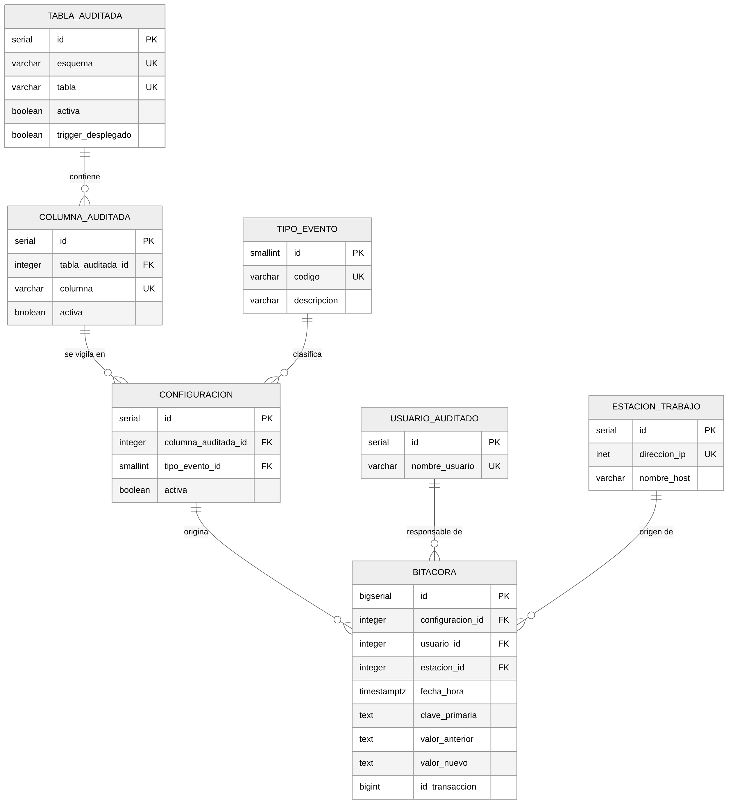

# Descripción general

AutoAudit es un sistema de auditoría configurable para bases de datos PostgreSQL. Su propósito es registrar, de forma automática y centralizada, todo cambio que ocurra sobre las columnas que el administrador decida vigilar, sin obligar a modificar las aplicaciones que producen esos cambios ni las tablas de negocio que los contienen.

El administrador indica qué tablas desea auditar, qué columnas de cada tabla y ante qué operaciones. A partir de esa configuración el sistema construye el código de los triggers necesarios y los instala sobre las tablas de origen. Desde ese momento cualquier inserción, modificación o eliminación que afecte a una columna vigilada queda asentada en una bitácora única, junto con el usuario responsable, la estación de trabajo desde la que se originó y el momento exacto en que ocurrió.

La solución se apoya por completo en el motor de base de datos. No existe un proceso externo que vigile las tablas ni una capa intermedia por la que deban pasar las aplicaciones, de modo que un cambio hecho directamente con una herramienta de consola queda registrado igual que uno producido por el sistema de información. Esa es la razón de fondo por la que la auditoría se implementa con triggers y no en la capa de aplicación.

El sistema está escrito en PL/pgSQL y se instala en un esquema propio llamado `audit`, separado de los esquemas de negocio. Fue desarrollado para PostgreSQL 18 sobre Ubuntu 26.04 LTS y validado también en PostgreSQL 16, pues no emplea ninguna construcción posterior a la versión 13.

# Modelo entidad-relación

El modelo se organiza alrededor de la entidad `configuracion`, que es el punto donde convergen la decisión de qué se vigila y el registro de lo que efectivamente ocurrió.

{width=100%}

## Entidades

La entidad `tabla_auditada` representa cada tabla del esquema de negocio que ha sido habilitada para auditoría. Guarda el esquema y el nombre de la tabla, una bandera que permite suspender la vigilancia sin perder la configuración, y una marca que indica si el trigger correspondiente ya está instalado en la base.

La entidad `columna_auditada` desciende de la anterior y representa cada columna vigilada dentro de una tabla habilitada. Su existencia es lo que hace posible la selección granular que exige el enunciado, pues permite auditar el salario de un empleado sin auditar su dirección.

La entidad `tipo_evento` es un catálogo fijo de tres filas que corresponde a las operaciones `INSERT`, `UPDATE` y `DELETE`. Se modeló como tabla y no como una restricción de tipo enumerado para que las consultas de reporte puedan unirse a ella y mostrar descripciones legibles sin codificar literales en el código de la aplicación.

La entidad `configuracion` une una columna vigilada con un tipo de evento. Cada una de sus filas expresa una decisión concreta del administrador, por ejemplo vigilar la columna salario ante operaciones de modificación. Es la entidad que el enunciado describe como la configuración que referencia los eventos que deben registrarse ante el cambio de una columna de una tabla.

Las entidades `usuario_auditado` y `estacion_trabajo` registran, respectivamente, los usuarios de base de datos que han producido cambios y los equipos desde los cuales se conectaron. Ambas se pueblan solas la primera vez que un usuario o una dirección aparecen, de modo que no requieren mantenimiento manual. La dirección de red admite nulos porque las conexiones hechas por socket local no reportan dirección, y todas ellas se agrupan en una única fila para no dispersar la información.

La entidad `bitacora` concentra el registro de cambios. Cada fila corresponde al cambio de una columna concreta en un registro concreto, e incluye el valor anterior y el valor nuevo, la clave primaria del registro afectado, el instante del cambio y el identificador de la transacción que lo produjo.

## Relaciones

Una tabla auditada contiene muchas columnas auditadas, y cada columna auditada participa en tantas configuraciones como tipos de evento se hayan habilitado para ella, con un máximo de tres. Un tipo de evento clasifica muchas configuraciones.

Cada registro de bitácora referencia la configuración específica que lo originó, el usuario responsable del cambio y la estación de trabajo desde donde se realizó. Estas tres referencias son las únicas llaves foráneas que salen de la bitácora, y las tres apuntan a entidades del propio sistema de auditoría.

La bitácora no lleva ninguna llave foránea hacia las tablas de negocio, y esta ausencia es deliberada. El enunciado exige que la bitácora preserve los datos originales aunque el registro fuente sea eliminado, y una llave foránea hacia el dato auditado volvería imposible esa eliminación o arrastraría la bitácora al borrarse el registro. La identidad del registro afectado se conserva en la columna `clave_primaria`, que almacena en texto los pares de columna y valor que forman la llave primaria, separados por una barra vertical cuando la llave es compuesta. De este modo la historia sigue siendo rastreable aunque la fila que la originó ya no exista.

Las llaves foráneas que sí existen se declararon con la acción `RESTRICT`. La consecuencia práctica es que una configuración con bitácora acumulada no puede eliminarse, lo cual protege la historia frente a un borrado accidental de la configuración. Para dejar de auditar una columna se desactiva la configuración en lugar de borrarla.

# Diccionario de datos

Las siete tablas del esquema `audit` se describen a continuación. El contenido de este apartado se generó consultando el catálogo del propio motor una vez instalado el sistema, de manera que refleja exactamente lo que el DDL produce.

### audit.tipo_evento

Catalogo de operaciones DML que el sistema puede auditar.


| Columna | Tipo | Nulos | Llave | Descripción |
|:--|:--|:--:|:--:|:--|
| `id` | smallint | No | PK |  |
| `codigo` | varchar(10) | No | UQ | Operacion DML: INSERT, UPDATE o DELETE. |
| `descripcion` | varchar(100) | No |  |  |


### audit.tabla_auditada

Tablas habilitadas para auditoria. Una fila por tabla origen.


| Columna | Tipo | Nulos | Llave | Descripción |
|:--|:--|:--:|:--:|:--|
| `id` | integer | No | PK |  |
| `esquema` | varchar(63) | No | UQ |  |
| `tabla` | varchar(63) | No | UQ |  |
| `activa` | boolean | No |  | Desactivar suspende la auditoria sin borrar la configuracion ni la bitacora. |
| `trigger_desplegado` | boolean | No |  | Indica si el trigger generado esta instalado en la tabla origen. |
| `fecha_registro` | timestamptz | No |  |  |
| `usuario_registro` | varchar(63) | No |  |  |


### audit.columna_auditada

Columnas vigiladas dentro de una tabla habilitada. Permite seleccion granular.


| Columna | Tipo | Nulos | Llave | Descripción |
|:--|:--|:--:|:--:|:--|
| `id` | integer | No | PK |  |
| `tabla_auditada_id` | integer | No | FK UQ |  |
| `columna` | varchar(63) | No | UQ |  |
| `activa` | boolean | No |  |  |
| `fecha_registro` | timestamptz | No |  |  |


### audit.configuracion

Une una columna vigilada con un tipo de evento. Cada fila de bitacora apunta aqui.


| Columna | Tipo | Nulos | Llave | Descripción |
|:--|:--|:--:|:--:|:--|
| `id` | integer | No | PK |  |
| `columna_auditada_id` | integer | No | FK UQ |  |
| `tipo_evento_id` | smallint | No | FK UQ |  |
| `activa` | boolean | No |  |  |
| `fecha_creacion` | timestamptz | No |  |  |
| `usuario_creacion` | varchar(63) | No |  |  |


### audit.usuario_auditado

Usuarios de base de datos que han producido cambios auditados. Alta automatica.


| Columna | Tipo | Nulos | Llave | Descripción |
|:--|:--|:--:|:--:|:--|
| `id` | integer | No | PK |  |
| `nombre_usuario` | varchar(63) | No | UQ |  |
| `primera_actividad` | timestamptz | No |  |  |
| `ultima_actividad` | timestamptz | No |  |  |


### audit.estacion_trabajo

Estaciones de trabajo identificadas por direccion de red. Una sola fila agrupa las conexiones locales.


| Columna | Tipo | Nulos | Llave | Descripción |
|:--|:--|:--:|:--:|:--|
| `id` | integer | No | PK |  |
| `direccion_ip` | inet | Si |  | Nulo para conexiones por socket local, que no reportan direccion de red. |
| `nombre_host` | varchar(255) | Si |  |  |
| `primera_actividad` | timestamptz | No |  |  |
| `ultima_actividad` | timestamptz | No |  |  |


### audit.bitacora

Registro centralizado de cambios. Conserva los datos aunque el registro fuente se elimine.


| Columna | Tipo | Nulos | Llave | Descripción |
|:--|:--|:--:|:--:|:--|
| `id` | bigint | No | PK |  |
| `configuracion_id` | integer | No | FK |  |
| `usuario_id` | integer | No | FK |  |
| `estacion_id` | integer | No | FK |  |
| `fecha_hora` | timestamptz | No |  |  |
| `clave_primaria` | text | No |  | Valor de la llave primaria del registro afectado, en texto. Permite rastrear la fila sin depender de que siga existiendo. |
| `valor_anterior` | text | Si |  | Valor previo de la columna. Nulo en INSERT. |
| `valor_nuevo` | text | Si |  | Valor posterior de la columna. Nulo en DELETE. |
| `id_transaccion` | bigint | No |  | Identificador de transaccion. Agrupa los cambios producidos por una misma sentencia o transaccion. |

# Módulos del sistema

El sistema se divide en cuatro módulos que corresponden al alcance funcional del enunciado. Los tres primeros viven por completo dentro de la base de datos, en el esquema `audit`, y el cuarto es la interfaz gráfica.

## Módulo de configuración

Concentra la validación y el control de acceso. Su punto de entrada es `audit.configurar_auditoria`, que recibe el esquema, la tabla, el arreglo de columnas a vigilar y el arreglo de eventos, y en una sola llamada valida, persiste y despliega.

La validación comprueba tres cosas contra el diccionario de datos del motor antes de tocar nada: que la tabla exista, que tenga llave primaria y que todas las columnas indicadas existan en ella. Rechaza además los eventos que no pertenezcan al catálogo y la auditoría del propio esquema `audit`, que produciría recursión infinita.

La decisión de colocar estas comprobaciones en la base y no en la interfaz responde a que la interfaz se puede modificar o evitar. Una configuración hecha desde `psql` pasa por los mismos controles que una hecha desde la aplicación, y el requisito de que solo usuarios administrativos puedan configurar auditoría se cumple de verdad, porque `audit.fn_exigir_administrador` aborta la operación cuando quien llama no es superusuario ni miembro del rol `autoaudit_admin`.

Toda la operación ocurre dentro de una transacción y el resultado del despliegue se comprueba antes de confirmarla. Esto importa porque `audit.regenerar_todos` no propaga las excepciones: captura el error de cada tabla y lo devuelve como texto en una columna del resultado. Quien no revise esa salida dará por buena una configuración cuyo trigger nunca se instaló, y peor aún, la dejará persistida, de modo que todo despliegue posterior de esa misma tabla fallará por la configuración inválida que quedó guardada.

Para suspender la auditoría existen cuatro funciones, que se diferencian por su alcance y por si obligan a regenerar el trigger. `audit.desactivar_evento` y `audit.activar_evento` operan sobre una combinación de columna y evento, y surten efecto de inmediato sin regenerar, porque la bandera de activación se consulta en tiempo de ejecución. `audit.desactivar_columna` deja de vigilar una columna entera y sí regenera, porque la lista de columnas va empotrada en el código del trigger; si era la última columna activa, retira el trigger. `audit.desactivar_tabla` y `audit.activar_tabla` suspenden y reanudan la tabla completa.

Ninguna de estas funciones elimina configuración. Se desactiva en lugar de borrar porque la bitácora referencia la configuración mediante una llave foránea con acción `RESTRICT`, de modo que borrarla sería imposible mientras exista historia acumulada, que es precisamente la protección que se buscaba.

## Módulo de generación de triggers

Descrito en el apartado de despliegue. Lo consume el módulo de configuración, que es quien decide cuándo regenerar.

## Módulo de consulta y reporte

La vista `audit.v_bitacora_detalle` presenta la bitácora con la tabla, la columna, el evento, el usuario y la estación ya resueltos, y es la base de los tres reportes que pide el enunciado.

Sobre ella se construyen las consultas parametrizadas. `audit.consultar_historial` acepta filtros opcionales por usuario, por columna, por esquema y tabla y por rango de fechas, que se combinan con conjunción lógica; omitirlos todos devuelve la bitácora completa. `audit.consultar_por_usuario` y `audit.consultar_por_columna` son envolturas que reciben nombres en lugar de identificadores. `audit.consultar_por_registro` devuelve la historia completa de un registro concreto en orden ascendente, y es la consulta que demuestra que la bitácora preserva los datos aunque el registro ya no exista en la tabla de origen.

Todas filtran internamente por identificador y no por nombre. La bitácora tiene índice sobre `usuario_id` y sobre `configuracion_id`, de manera que filtrar por el identificador descarta filas antes de resolver las uniones, mientras que filtrar por el nombre obliga a unir primero y recorrer mucho más. Las funciones que reciben nombres resuelven el nombre a identificador en un paso aparte y luego delegan, para conservar esa ventaja.

La vista `audit.v_resumen_actividad` agrega los cambios por usuario, objeto y tipo de evento, con la primera y la última fecha de cada combinación.

## Interfaz

La interfaz está escrita en Python con `tkinter` y se comunica con la base mediante `psycopg2`. Reside en `app/autoaudit_app.py` y se organiza en tres pestañas: configuración, bitácora y estado.

No construye instrucciones de configuración por su cuenta. Llama a las funciones descritas arriba y se limita a traducir sus errores a mensajes legibles, de modo que la lógica de validación existe en un solo lugar. El código separa una clase de acceso a datos, sin dependencia de `tkinter`, de la clase que arma las ventanas, lo que permite probar la capa de datos sin necesidad de un entorno gráfico.

Los parámetros de conexión se leen de variables de entorno. No hay credenciales escritas en el código fuente, que es un requisito elemental cuando el repositorio es público.

# Procedimiento de instalación y despliegue

## Requisitos previos

Se requiere PostgreSQL 18 en funcionamiento sobre Ubuntu 26.04 LTS, una base de datos destino donde residan las tablas de negocio, y un usuario con privilegios suficientes para crear esquemas, funciones y triggers en esa base. La instalación no necesita extensiones adicionales.

## Instalación del esquema

Los guiones se ejecutan en orden sobre la base de datos destino, pues cada uno depende de los objetos que crea el anterior. El primero levanta el esquema y las siete tablas, el segundo carga el catálogo de eventos y las funciones de contexto, el tercero instala el generador de triggers y el cuarto las vistas de consulta al diccionario de datos del motor.

```
psql -d basedatos -f sql/00_instalar.sql
```

Ese guion ejecuta en orden los seis que componen el sistema: el esquema y sus siete tablas, el catálogo de eventos y las funciones de contexto, el generador de triggers, las vistas de consulta al diccionario del motor, el módulo de configuración y el módulo de consulta y reporte. Cada uno depende de los objetos que crea el anterior, de modo que el orden importa.

Al terminar, la base contiene el esquema `audit` sin ninguna tabla de negocio habilitada todavía. El sistema queda instalado pero inactivo, que es el estado correcto antes de decidir qué se va a vigilar.

## Despliegue de los triggers

El despliegue es un paso separado de la configuración y debe ejecutarse cada vez que la configuración cambie de forma estructural. La función `audit.regenerar_todos()` recorre las tablas habilitadas, construye el trigger de cada una y lo instala, y al mismo tiempo retira los triggers de las tablas que hayan sido desactivadas. Devuelve una fila por tabla con el resultado de la operación, de manera que un fallo en una tabla concreta queda visible sin interrumpir el despliegue de las demás.

```
SELECT objeto, resultado FROM audit.regenerar_todos();
```

Cuando se desea revisar el código antes de instalarlo, la función `audit.generar_trigger` lo devuelve como texto sin ejecutarlo. Acepta el identificador de la tabla auditada o bien el par de esquema y tabla.

```
SELECT audit.generar_trigger('rrhh', 'empleado');
```

Para instalar o retirar el trigger de una sola tabla existen `audit.aplicar_trigger` y `audit.eliminar_trigger`, ambas identificadas por el identificador de la tabla auditada. Retirar un trigger no borra la bitácora acumulada.

El estado del despliegue puede consultarse en cualquier momento en la vista `audit.v_estado_auditoria`, que muestra por tabla cuántas columnas se vigilan, cuántos eventos están configurados y si el trigger se encuentra instalado.

# Manual de configuración y activación de auditoría por tabla

El sistema puede configurarse desde la interfaz gráfica o directamente con SQL. Ambas vías ejecutan las mismas funciones y aplican las mismas validaciones, de modo que la elección es solo de comodidad.

## Qué puede auditarse

Solo las tablas que tienen llave primaria. Sin ella la bitácora no podría identificar el registro afectado, y tanto el generador como el módulo de configuración las rechazan. La vista `audit.v_diccionario_tablas` lista las tablas de los esquemas de usuario e indica cuáles cumplen el requisito; la vista `audit.v_diccionario_columnas` hace lo propio con las columnas y muestra el tipo de dato de cada una. La interfaz gráfica solo ofrece las tablas que pasan el filtro, así que desde ahí el error no es posible.

Tampoco puede auditarse el esquema `audit`, porque auditar la bitácora con la bitácora produciría recursión infinita.

## Activar la auditoría de una tabla

Desde SQL basta una llamada. El siguiente ejemplo vigila tres columnas de una tabla de empleados ante las tres operaciones:

```
SELECT audit.configurar_auditoria(
           'rrhh', 'empleado',
           ARRAY['nombre', 'puesto', 'salario'],
           ARRAY['INSERT', 'UPDATE', 'DELETE']);
```

La función devuelve un texto que confirma cuántas configuraciones quedaron activas y que el trigger se desplegó. Si algo falla, lanza una excepción con el motivo y no deja nada guardado.

El cuarto argumento es opcional y por omisión habilita las tres operaciones. Una columna que solo interese durante modificaciones se configura pasando `ARRAY['UPDATE']`, y así se evita llenar la bitácora con inserciones que no aportan información.

Desde la interfaz gráfica, el procedimiento es elegir la tabla en el desplegable, marcar una o varias columnas en la lista, marcar los eventos y pulsar el botón de activar. Las columnas se eligen con las teclas Control o Mayúsculas para seleccionar varias de una vez.

## Suspender y reanudar

El sistema distingue entre cambios estructurales y cambios de activación, y los trata de forma distinta por una razón de rendimiento.

Desactivar un evento concreto sobre una columna surte efecto de inmediato, sin regenerar el trigger, porque la función que escribe en la bitácora consulta la bandera de activación en cada llamada. Es la vía recomendada para suspender temporalmente la auditoría durante una carga masiva.

```
SELECT audit.desactivar_evento('rrhh', 'empleado', 'salario', 'UPDATE');
SELECT audit.activar_evento   ('rrhh', 'empleado', 'salario', 'UPDATE');
```

Dejar de vigilar una columna entera sí modifica la estructura del trigger, de modo que la función regenera por su cuenta. Si la columna era la última activa de la tabla, el trigger se retira.

```
SELECT audit.desactivar_columna('rrhh', 'empleado', 'puesto');
```

Suspender la tabla completa retira su trigger y conserva tanto la configuración como la bitácora acumulada, de manera que la auditoría puede reanudarse más adelante sin volver a configurarla.

```
SELECT audit.desactivar_tabla('rrhh', 'empleado');
SELECT audit.activar_tabla   ('rrhh', 'empleado');
```

En la interfaz gráfica estas cuatro acciones están en el recuadro inferior de la pestaña de configuración, y la reanudación de una tabla suspendida también puede hacerse desde la pestaña de estado, seleccionando la tabla en la lista.

## Comprobar el estado

La vista `audit.v_estado_auditoria` muestra, por tabla, cuántas columnas se vigilan, cuántos eventos hay configurados de cada tipo y si el trigger está instalado. Una tabla con la bandera de activación y la de despliegue en falso está suspendida pero conserva su configuración.

```
SELECT * FROM audit.v_estado_auditoria;
```

## Consultar la bitácora

Las tres consultas que pide el enunciado se resuelven con una llamada cada una.

```
SELECT * FROM audit.consultar_por_usuario('isai');
SELECT * FROM audit.consultar_por_columna('rrhh', 'empleado', 'salario');
SELECT * FROM audit.consultar_por_registro('rrhh', 'empleado', 'id=42');
```

Para combinar filtros o acotar por fechas se usa la función general, cuyos parámetros son todos opcionales:

```
SELECT * FROM audit.consultar_historial(
           p_esquema => 'rrhh',
           p_tabla   => 'empleado',
           p_desde   => '2026-11-01',
           p_limite  => 500);
```

Los resultados vienen en orden cronológico descendente, del cambio más reciente al más antiguo, salvo la consulta por registro, que va en orden ascendente porque ahí interesa leer la historia desde el principio.

Desde la interfaz, la pestaña de bitácora ofrece los mismos filtros en desplegables y campos de fecha, y exporta lo que muestra a un archivo CSV codificado de modo que Excel reconozca los acentos sin configurar nada.

## Requisitos de privilegios

Configurar auditoría exige ser superusuario o miembro del rol `autoaudit_admin`, que el guion de instalación crea. Para otorgar el privilegio a un usuario:

```
GRANT autoaudit_admin TO nombre_de_usuario;
```

Consultar la bitácora no requiere privilegios especiales. Escribir directamente en ella está revocado para todos, y las únicas inserciones posibles provienen de las funciones de trigger.

Conviene advertir que desplegar un trigger exige además privilegio para crearlo sobre la tabla de origen, que en PostgreSQL corresponde a quien la posee. En una instalación donde el administrador de auditoría no sea el dueño de las tablas de negocio, la configuración se guardará pero el despliegue fallará, y la función lo informará con un error explícito en lugar de darlo por bueno.

# Pruebas de validación

## Pruebas funcionales

Se construyó un juego de nueve casos que cubre los criterios de aceptación del enunciado y se ejecuta de forma automática. Cada caso comprueba su resultado mediante aserciones y aborta la ejecución del guion al primer fallo, de modo que una ejecución completa sin errores equivale a que los nueve casos pasaron.

Los tres primeros casos verifican el comportamiento básico. Una inserción produce un registro por cada columna vigilada, con el valor nuevo capturado y el valor anterior nulo, y con usuario, estación y fecha poblados. Una modificación captura el valor anterior y el nuevo de la columna afectada. Una modificación que no altera ninguna columna vigilada, o que reasigna el mismo valor que ya tenía, no genera ningún registro, lo cual evita que la bitácora se llene de filas sin contenido informativo.

El cuarto caso verifica la exigencia central del enunciado. Tras eliminar un registro de la tabla de origen se comprueba que la fila ya no existe, que el borrado quedó asentado con el último valor conocido de cada columna vigilada, y que la historia completa de ese registro, desde su inserción hasta su eliminación, sigue disponible en la bitácora.

El quinto caso ejercita una tabla con llave primaria compuesta y comprueba que el identificador del registro se arma correctamente concatenando los pares de columna y valor.

El sexto caso comprueba el comportamiento de activación en caliente descrito en el manual. Al desactivar una configuración, un cambio posterior sobre esa columna no produce registro, y al reactivarla el registro se reanuda, todo ello sin regenerar el trigger.

Los casos séptimo y octavo verifican las validaciones del generador. Una tabla sin llave primaria y una columna que no existe en la tabla de origen son rechazadas con errores específicos en lugar de producir un trigger defectuoso.

El noveno caso comprueba que la integridad referencial protege la historia, confirmando que una configuración con bitácora asociada no puede eliminarse. Esta prueba reveló una diferencia entre versiones del motor que conviene dejar anotada. PostgreSQL 18 cambió el código de error que acompaña a las acciones `RESTRICT`, que pasó de 23503, correspondiente a violación de llave foránea, a 23001, correspondiente a violación de restricción. El cambio no figura en las notas de versión, de modo que cualquier código que atrape únicamente 23503 deja de reconocer estas violaciones al actualizar a la versión 18. El manejador de la prueba atrapa ambas condiciones y por eso funciona igual en la versión 16 y en la 18.

## Pruebas del módulo de configuración

Un segundo juego de trece casos, en `pruebas/05_pruebas_configuracion.sql`, cubre el módulo de configuración y el de consulta con el mismo esquema de aserciones.

Los cinco primeros verifican la validación. Una configuración válida persiste y despliega en una sola llamada. Una tabla inexistente, una tabla sin llave primaria, una columna inexistente, un evento fuera del catálogo y el intento de auditar el propio esquema `audit` son rechazados, cada uno con su código de error específico. El caso de la columna inexistente comprueba además que no quedó nada guardado, que es el fallo concreto que la primera versión de la interfaz dejaba pasar.

Los casos sexto, séptimo y octavo recorren el ciclo de suspensión y reanudación en sus tres alcances. Desactivar un evento detiene el registro sin regenerar el trigger y reactivarlo lo reanuda. Desactivar una columna regenera y deja de registrarla mientras las demás siguen vigiladas. Suspender la tabla retira el trigger, conserva la bitácora acumulada y permite reanudar.

Los casos noveno y décimo verifican la seguridad. Se crea un rol sin privilegios y se comprueba que la base rechaza su intento de configurar auditoría y su intento de escribir directamente en la bitácora. Ambos rechazos ocurren en el motor, no en la aplicación.

Los tres últimos cubren las consultas. Las funciones parametrizadas devuelven resultados coherentes entre sí, el historial viene efectivamente en orden cronológico descendente, el filtro por rango de fechas acota como corresponde, y la historia de un registro sigue disponible y crece tras eliminarlo de la tabla de origen.

## Pruebas de rendimiento

Se midió el costo que la auditoría agrega a las operaciones de escritura con volúmenes crecientes, comparando la misma carga con el trigger instalado y sin él. La tabla de prueba tiene tres columnas vigiladas ante las tres operaciones, que es la configuración más exigente posible para una tabla de ese tamaño. Las cifras que siguen corresponden a PostgreSQL 18.6 sobre Fedora 44.

| Operación | Volumen | Sin auditoría | Con auditoría | Costo por fila |
|:--|--:|--:|--:|--:|
| INSERT | 1 000 | 2,05 ms | 59,0 ms | 59 µs |
| INSERT | 5 000 | 6,31 ms | 293,3 ms | 59 µs |
| INSERT | 20 000 | 26,27 ms | 1 350,1 ms | 68 µs |
| INSERT | 50 000 | 63,79 ms | 4 978,4 ms | 100 µs |
| UPDATE | 20 000 | | 570,3 ms | 29 µs |
| DELETE | 10 000 | | 796,4 ms | 80 µs |

El dato relevante de esta tabla no es la diferencia frente a la línea base sino la última columna y, sobre todo, cómo evoluciona. El costo por fila sube de cincuenta y nueve a cien microsegundos conforme la bitácora pasa de tres mil a doscientas veintiocho mil filas. Ese crecimiento es esperable y no delata un defecto de diseño. La bitácora sostiene cuatro índices, y el costo de insertar en un árbol B crece con el logaritmo del número de filas almacenadas. Puesto en proporción, la bitácora creció setenta y cinco veces mientras el costo unitario apenas se multiplicó por uno coma siete, que es la señal de un mecanismo que escala de forma aceptable y no de uno que se degrada.

Conviene aclarar cómo se tomaron las mediciones, porque afecta su lectura. Las cuatro ejecuciones no son independientes entre sí: cada una parte de la bitácora que dejó la anterior, de modo que la de cincuenta mil registros se ejecuta sobre una bitácora que ya acumulaba setenta y ocho mil filas. Esa acumulación es justamente la condición que se quería observar, pues el objetivo era medir el comportamiento con volumen creciente y no el rendimiento sobre una tabla recién creada.

Conviene interpretar con cuidado la comparación contra la línea base. Una inserción masiva sin auditoría cuesta alrededor de un microsegundo y medio por fila, de modo que cualquier trabajo adicional produce un porcentaje de sobrecosto aparentemente enorme. En una operación individual de un sistema transaccional, donde el costo de la sentencia incluye la latencia de red y el manejo de la transacción, un incremento de entre sesenta y cien microsegundos es imperceptible. En una carga masiva de cientos de miles de registros, en cambio, el sobrecosto sí resulta significativo, y la recomendación es suspender la auditoría de las columnas afectadas mientras dura la carga y reanudarla al terminar, tal como permite el mecanismo de activación descrito antes.

Las consultas históricas sobre la bitácora cargada con doscientas ochenta y cuatro mil filas respondieron por debajo de la décima de milisegundo cuando filtran por columna o por registro afectado. La consulta por usuario tardó once milisegundos, pero en el escenario de prueba todas las filas pertenecían a un mismo usuario, de modo que esa cifra corresponde a recorrer la bitácora completa y no a una búsqueda selectiva.

## Una corrección de diseño surgida de estas pruebas

La primera versión del sistema resolvía el usuario y la estación de trabajo en cada columna modificada, mediante una inserción condicional sobre las tablas correspondientes. Las pruebas de rendimiento revelaron que ese diseño era inviable, pues una carga de cincuenta mil registros con tres columnas vigiladas ejecutaba cientos de miles de actualizaciones sobre tablas de una sola fila, acumulaba versiones muertas de esa fila y degradaba el rendimiento hasta el punto de no completar la prueba.

La solución fue resolver el usuario y la estación una sola vez por sesión y conservar los identificadores en variables de configuración de sesión. Como estas variables son transaccionales, si la transacción se revierte el valor almacenado se descarta junto con el alta del usuario, de modo que la memoria intermedia nunca queda apuntando a una fila inexistente. Con ese cambio la prueba que antes no terminaba pasó a ejecutarse en ocho segundos.

# Limitaciones conocidas

El generador exige que la tabla de origen tenga llave primaria. Una tabla sin ella no puede auditarse, pues no habría forma de identificar en la bitácora el registro afectado.

Los valores se almacenan convertidos a texto. Esto permite una bitácora única para tablas de estructuras distintas, pero implica que una comparación posterior entre el valor anterior y el nuevo debe tener en cuenta el formato de conversión del tipo original.

Un cambio estructural en la configuración no surte efecto hasta que se regeneran los triggers. Este comportamiento es intencional, porque la lista de columnas vigiladas va empotrada en el código del trigger y es justamente lo que mantiene bajo el costo por fila, pero obliga a recordar el paso de regeneración.

Las operaciones que no pasan por el mecanismo de triggers no quedan registradas. Es el caso de `TRUNCATE`, que no dispara triggers de fila, y de las modificaciones hechas directamente sobre los archivos de datos del motor.

La dirección de red se registra solo cuando la conexión la reporta. Las conexiones por socket local se agrupan bajo una única estación identificada como conexión local.
